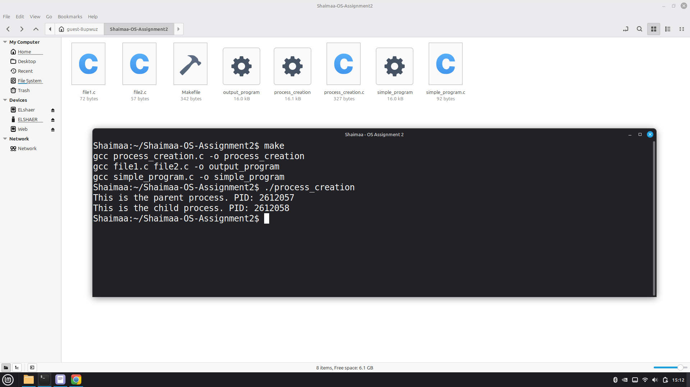
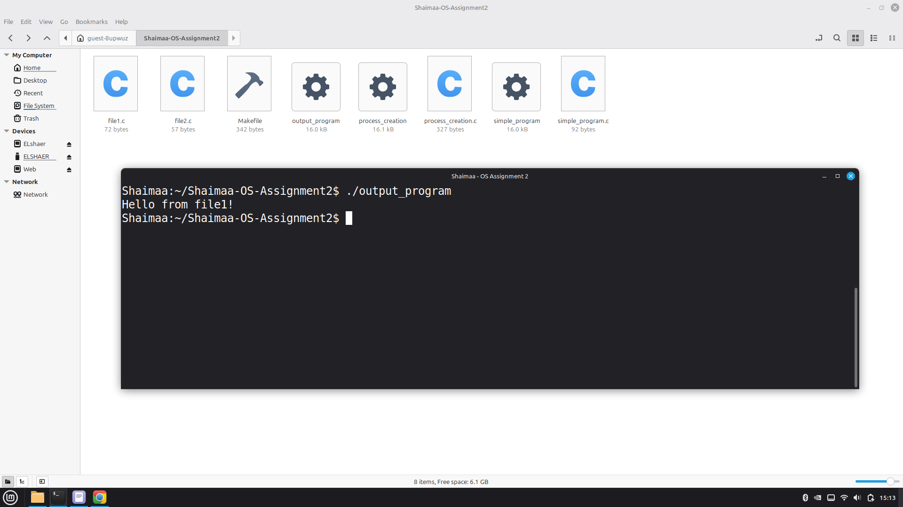

# Operating Systems - Assignment 2

**Name:** Shaimaa Mohamed Kotit
**ID:** 24100570

Basic forks and C Style Development

## Description

This project practices process creation, linking C files and checking shared libraries using the examples from Lab 5.

## Requirements

Linux, GCC and Make.

## Installation

On Ubuntu, install the required tools:

```bash
sudo apt install gcc make
```

## Usage

Compile all examples:

```bash
make
```

Run the programs:

```bash
./process_creation
./output_program
./simple_program
ldd simple_program
```

The process IDs and the order of the parent and child messages may change between runs.

To remove the executable files:

```bash
make clean
```

## Files

- `process_creation.c`: creates a child process using fork().
- `file1.c` and `file2.c`: demonstrate linking two C files.
- `simple_program.c`: demonstrates a program used with ldd.
- `answers.txt`: explanations and process control commands.
- `Makefile`: compiles the programs.

## Screenshots

### 1. Process Creation (fork)

```bash
make clean
make
./process_creation
```



### 2. Linker

```bash
./output_program
```



### 3. Loader

```bash
./simple_program
ldd simple_program
```


## License

This project is licensed under the MIT License.
See [LICENSE](LICENSE) for the full text.
